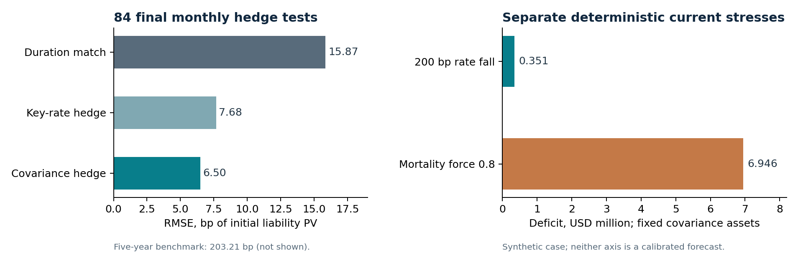

# Treasury ALM: hedge stability, longevity and liquidity

**Prasanna K** | Official Federal Reserve curves and SSA mortality | Completed October 2026

How much does a better rate hedge improve a benefit portfolio, and which
funding risks remain? This research joins a frozen historical hedge comparison
to an independently reconciled synthetic balance-sheet case.

**[Explore the saved scenarios](https://prasanna-k-123.github.io/treasury-alm/)**
| [Decision brief](output/pdf/Treasury_ALM_Decision_Brief.pdf)
| [Technical report](output/pdf/Treasury_ALM_Technical_Report.pdf)
| [Formula workbook](artifacts/Treasury_ALM_Reconciliation.xlsx)

## Findings that matter

| Question | Evidence | Interpretation |
| --- | --- | --- |
| Does the selected hedge improve rate stability? | Final 84-month surplus RMSE **6.50bp versus 15.87bp** for duration matching; **59.03% lower**. Paired six-month block 95% difference **[-12.34, -6.02]bp**. | Supports the development-selected covariance hedge against the declared duration benchmark in this experiment. |
| Does rate hedging remove longevity exposure? | A mortality-force multiplier of 0.8 raises the USD119.38m synthetic liability by **USD6.95m (5.82%)**. | A rate hedge does not offset imposed longevity sensitivity. This multiplier is not a calibrated forecast. |
| Does the lowest rate RMSE imply the lowest liquidity cost? | At base mortality/cash and a 2% sale haircut, year-ten funding surplus is **-USD0.705m** for covariance versus **-USD0.641m** for key-rate. | The rate-risk and liquidity objectives differ. The full 108-case runoff ledger is retained. |

Historical basis points are fractions of each experiment's initial liability
PV, not yield changes or investment returns. Hypothetical zeros and reset
monthly liabilities are used, with no realised trading-profit claim.

## What is built

- **Term-structure and hedge engine:** continuous-compounding Svensson curves,
  exact maturity roll, analytic/key-rate risk, long-only constrained hedges and
  training-only covariance.
- **Frozen evaluation:** 180 training, 48 development and 84 final months;
  fixed simplicity rule, sealed predictions and paired block uncertainty.
- **Balance-sheet ledger:** four synthetic cohorts, 56 instantaneous portfolio
  stresses and 108 ten-year runoff scenarios with forced sales, reinvestment
  assumptions and explicit unpaid-benefit carry.
- **Independent controls:** 50-digit Decimal verification, exhaustive bound-face
  checks for both current constrained optima, and a seven-sheet formula workbook.
- **Reviewable deliverables:** technical report, decision brief, raw annual
  ledger, original source audit, reproduction receipt and saved-scenario explorer.

## Evidence and reproduction

All **31 boundary checks** pass. The independent ledger makes **23,714 numeric
comparisons**; the workbook makes **22,166**, with financial tolerance
USD0.0001 and maximum workbook financial discrepancy USD0.0000001341.
All **eight scientific outputs reproduce byte-for-byte** in a clean integrated
run. A rebuilt workbook has equivalent formulas, inputs, cached results,
formatting, validation and panes. Native desktop Excel and external independent
replication are not claimed.

Start with [REPRODUCE.md](REPRODUCE.md) and the
[integrated receipt](reports/integrated_20261019/full_study_reproduction.json).
The [workbook guide](reports/workbook_20261019/WORKBOOK.md) distinguishes
imported portfolio weights/faces from independent spreadsheet calculations.

## Source integrity and boundaries

The study pins one original Fed CSV vintage. All 313 required month-end curves
and the September 2026 case curve pass the fixed 0.02bp reconstruction rule;
two other daily observations remain explicitly quarantined. The downloaded
historical vintage can contain revisions. SSA 2023 period mortality describes
the US Social Security area, not Indian annuitants or future cohorts.

The current portfolio and contracts are synthetic nominal USD. Mortality
forces, liquidation haircuts, future reinvestment and curve extrapolation are
stated assumptions. Neither calibrated shortfall probabilities, solvency
capital, regulatory approval nor universal hedge dominance are established.
See [SOURCES.md](SOURCES.md) and the full technical report.

The frozen design documents retain their original pre-execution wording and
hashes. Their references to an unfinished/private study describe the design
date; this README and the release evidence describe the completed publication.
The public repository begins with a clean source history; the earlier private
Indian retirement illustration and its inputs are excluded.

[Five-minute reviewer guide](reports/integrated_20261019/RECRUITER_GUIDE.md)

## License

Original code and authored reports are available under the [MIT License](LICENSE).
Government source material retains its own [public-use terms](SOURCES.md).
